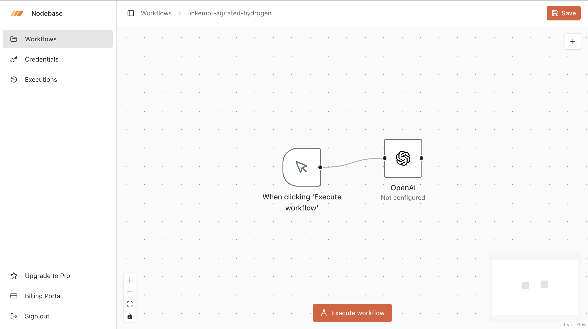
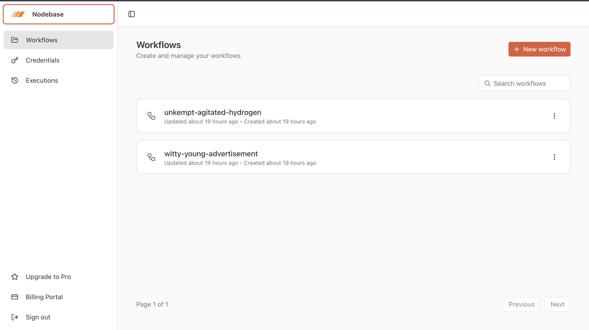
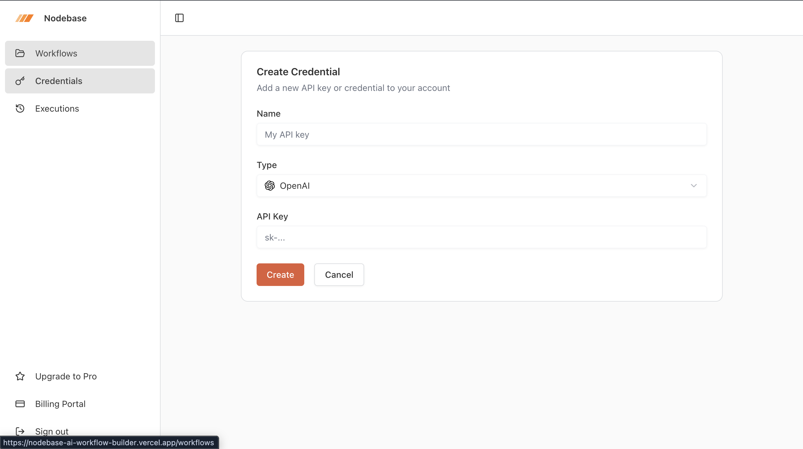
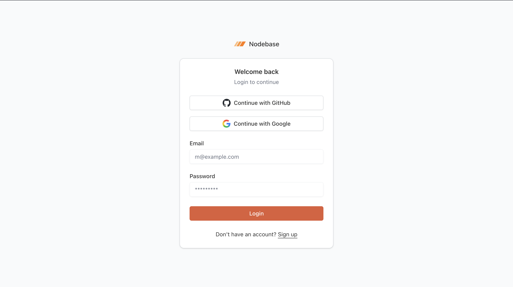
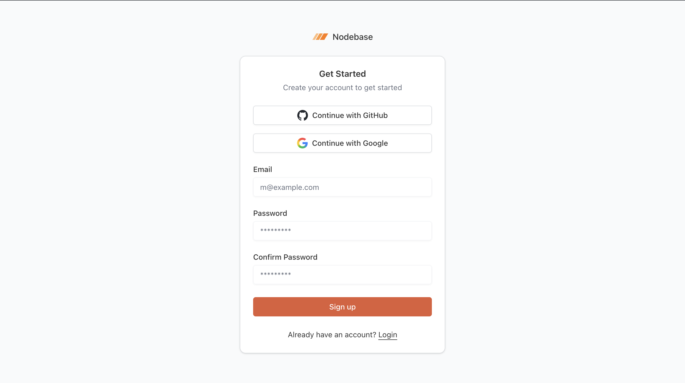
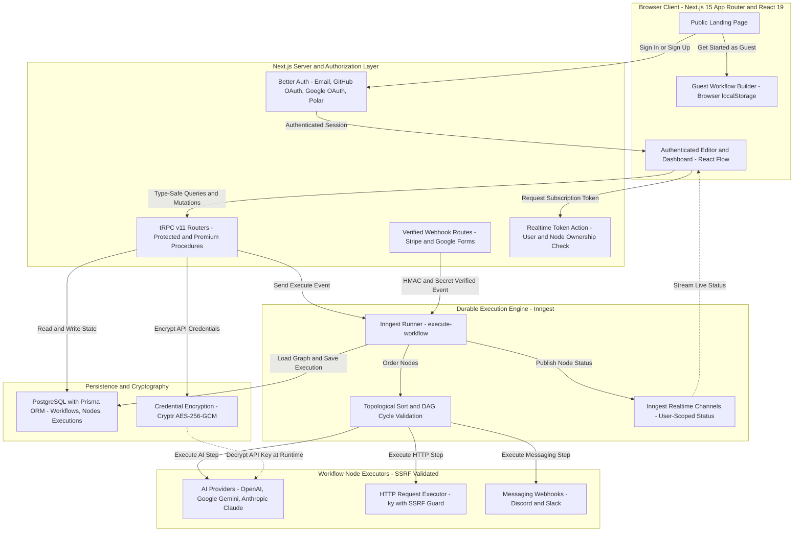

<div align="center">
  

  # NodeBase — AI Workflow Builder

  **Visual AI workflow automation platform for designing, orchestrating, and monitoring multi-step LLM and API pipelines.**

  [](https://nodebase-ai-workflow-builder.vercel.app)
  [](https://nodebase-ai-workflow-builder.vercel.app/workflows/demo)
  [](https://nextjs.org/)
  [](https://react.dev/)
  [](https://www.typescriptlang.org/)
  [](https://www.prisma.io/)
  [](https://www.inngest.com/)

  [Live Application](https://nodebase-ai-workflow-builder.vercel.app) •
  [Get Started as Guest](https://nodebase-ai-workflow-builder.vercel.app/workflows/demo) •
  [Architecture](#system-architecture) •
  [Local Setup](#local-setup-guide) •
  [Security](#security-architecture--protections)
</div>

---

## Overview

**NodeBase** is a full-stack visual workflow builder that connects manual triggers and incoming webhooks to Large Language Models (**OpenAI**, **Google Gemini**, **Anthropic Claude**), outbound **HTTP REST APIs**, and team messaging channels (**Slack**, **Discord**).

### The Problem NodeBase Solves

Engineering and operations teams frequently stitch together webhooks, REST APIs, LLM prompts, and chat notifications using brittle glue scripts that lack retry semantics, credential isolation, execution visibility, or cycle validation. NodeBase replaces ad-hoc scripts with a directed acyclic graph (DAG) canvas backed by durable step execution:

- **For Developers & AI Engineers:** Visually chain multi-provider LLM calls with Handlebars context interpolation (`{{variable}}` and `{{json variable}}`), deterministic topological sorting, and step-level retries via Inngest.
- **For Technical Evaluators & Visitors:** Click **[Get Started as Guest](https://nodebase-ai-workflow-builder.vercel.app/workflows/demo)** on the live application to open the interactive React Flow builder immediately in the browser—no account creation or login barrier required.

---

## Table of Contents

- [Overview](#overview)
- [Product Tour & Screenshots](#product-tour--screenshots)
- [Features & Capabilities](#features--capabilities)
  - [Guest Demo vs. Authenticated Cloud Workspace](#guest-demo-vs-authenticated-cloud-workspace)
- [System Architecture](#system-architecture)
  - [Workflow Execution Lifecycle](#workflow-execution-lifecycle)
- [Technology Stack](#technology-stack)
- [Local Setup Guide](#local-setup-guide)
- [Environment Variables Reference](#environment-variables-reference)
- [Testing, Quality Assurance & Scripts](#testing-quality-assurance--scripts)
- [Security Architecture & Protections](#security-architecture--protections)
- [Limitations & Troubleshooting](#limitations--troubleshooting)
- [Project Structure](#project-structure)
- [Roadmap](#roadmap)
- [Contributing](#contributing)
- [License & Credits](#license--credits)

---

## Product Tour & Screenshots

### 1. Visual Workflow Builder Canvas

Design directed acyclic workflows on an interactive React Flow canvas with snap-to-grid alignment, zoom/pan controls, a mini-map, node configuration dialogs, and one-click execution.



### 2. Workflows Workspace Dashboard

Manage persisted workflows with search, pagination, creation timestamps, and quick navigation across Workflows, Credentials, and Executions.



### 3. Encrypted Credential Management

Store provider API keys for OpenAI, Google Gemini, and Anthropic. Keys are encrypted prior to database persistence and masked in all API responses.



### 4. Authentication — Sign In & Account Registration

Authenticate with email/password or OAuth providers (GitHub and Google) powered by Better Auth, with validated post-authentication redirect handling.

| Sign In (`/login`) | Create Account (`/signup`) |
| :---: | :---: |
|  |  |

---

## Features & Capabilities

### Visual Drag-and-Drop Editor
- **Interactive DAG Canvas:** Built on `@xyflow/react` with custom node components, connection handles, mini-map navigation, and keyboard accessibility.
- **Graph Integrity & Sanitization:** Automatically strips self-loops, dangling edges referencing removed nodes, and duplicate connections before saving.
- **Cycle Detection:** Validates workflows with topological sorting (`toposort`) so cyclic graphs are rejected before execution.

### Instant Guest Mode (`Get Started as Guest`)
- **Zero-Barrier Entry:** Clicking **Get Started as Guest** on `/` opens `/workflows/demo` directly without redirecting to `/login` or `/signup`.
- **Preloaded Demo Pipeline:** Loads the *Weather AI Summary (Demo)* pipeline (`Manual Trigger` → `HTTP Request` → `Gemini`) so visitors can inspect node configurations, add new nodes, connect edges, and edit prompts immediately.
- **Browser-Scoped Persistence:** Guest edits automatically persist to `localStorage` (`nodebase:guest-demo-workflow:v1`) with strict size (100 KB) and node-count (50 nodes) bounds, alongside **Save Draft** and **Reset Demo** controls.

### Triggers
- **Manual Trigger (`MANUAL_TRIGGER`):** Run workflows on demand from the editor canvas (enforces at most one manual trigger per workflow).
- **Google Form Webhook (`GOOGLE_FORM_TRIGGER`):** Trigger executions via `POST /api/webhooks/google-form?workflowId=<id>` with shared-secret authentication (`x-webhook-secret` header or `secret`/`token` query parameter) and Apps Script payload normalization.
- **Stripe Event Webhook (`STRIPE_TRIGGER`):** Trigger executions via `POST /api/webhooks/stripe?workflowId=<id>` verified with HMAC-SHA256 `stripe-signature` checking and a 300-second replay window.

### Multi-Provider AI Orchestration
- **OpenAI (`OPENAI`):** Generates text via `@ai-sdk/openai` (`gpt-4`) using the workflow owner's decrypted OpenAI credential.
- **Google Gemini (`GEMINI`):** Generates text via `@ai-sdk/google` (`gemini-2.0-flash`) using the workflow owner's decrypted Gemini credential.
- **Anthropic Claude (`ANTHROPIC`):** Generates text via `@ai-sdk/anthropic` (`claude-sonnet-4-5`) using the workflow owner's decrypted Anthropic credential.
- **Dynamic Prompt Templating:** System and user prompts compile with **Handlebars**, allowing downstream nodes to reference upstream outputs via `{{variableName.text}}`, `{{httpResponse.data}}`, or `{{json variableName}}`.

### HTTP & Messaging Actions
- **HTTP Request (`HTTP_REQUEST`):** Executes outbound `GET`, `POST`, `PUT`, `PATCH`, and `DELETE` requests via `ky` with Handlebars URL and JSON body templating, 30-second timeouts, redirect blocking, and SSRF validation.
- **Discord Webhook (`DISCORD`):** Posts formatted messages (up to 2,000 characters) and custom usernames to Discord webhook URLs with HTML entity decoding and SSRF validation.
- **Slack Webhook (`SLACK`):** Delivers workflow outputs to Slack webhook endpoints with Handlebars templating and SSRF validation.

### Durable Execution, Realtime Status & Observability
- **Inngest Background Engine:** Executes each workflow step durably (`step.run` and `step.ai.wrap`) with automatic retries in production (`retries: 3`) and failure capture (`onFailure`).
- **Live Node Status Indicators:** Streams `loading`, `success`, and `error` states to the canvas over user-isolated `@inngest/realtime` channels.
- **Execution History:** Records `RUNNING`, `SUCCESS`, and `FAILED` execution runs in PostgreSQL with start/completion timestamps, final context output JSON, and error stack traces.
- **Sentry Error Tracking:** Captures server, client, and edge exceptions via `@sentry/nextjs` with PII and AI prompt/output recording disabled (`sendDefaultPii: false`, `recordInputs: false`, `recordOutputs: false`).

### Guest Demo vs. Authenticated Cloud Workspace

| Capability | Guest Mode (`/workflows/demo`) | Authenticated Workspace |
| :--- | :--- | :--- |
| **Access Requirement** | None (**Get Started as Guest**) | Email/Password, GitHub OAuth, or Google OAuth |
| **Canvas Editing & Node Configuration** | Full visual canvas, add/connect nodes, edit prompts | Full visual canvas, add/connect nodes, edit prompts |
| **Draft Persistence** | Browser `localStorage` (`100 KB` / `50 nodes` max) | PostgreSQL via Prisma ORM + tRPC |
| **Encrypted API Credential Storage** | Disabled (isolated from server database) | Enabled (`OPENAI`, `GEMINI`, `ANTHROPIC`) |
| **Cloud Workflow Execution (Inngest)** | Disabled (prompts user to create a free account) | Enabled (requires configured provider credentials) |
| **Execution History & Logs (`/executions`)** | Protected (redirects to `/login`) | Full execution history and output inspection |
| **Inbound Webhooks (Stripe / Google Forms)** | Not applicable | Enabled when webhook secrets are configured |

---

## System Architecture



### Workflow Execution Lifecycle

1. **Configuration & Graph Validation:** When an authenticated user saves a workflow in the React Flow editor, `workflows.update` sanitizes all edges (removing self-loops, dangling references, and duplicate edges) and persists nodes and connections inside a single Prisma `$transaction`.
2. **Trigger Dispatch:** A workflow is triggered either manually from the editor (`workflows.execute` tRPC mutation) or via an incoming authenticated webhook (`POST /api/webhooks/stripe` or `POST /api/webhooks/google-form`), which dispatches a `workflows/execute.workflow` event to Inngest.
3. **Topological Ordering:** The `execute-workflow` Inngest function creates an `Execution` record (`RUNNING`), loads the workflow graph from PostgreSQL, and runs `topologicalSort()` to determine a valid linear execution order or abort if a cycle is detected.
4. **Step-by-Step Execution & Context Propagation:** Each node runs inside its own deterministic Inngest step (`step.run` or `step.ai.wrap` with node-scoped IDs). Every node receives the shared `context` object, compiles its Handlebars templates, executes its integration, and merges its output back into `context[variableName]`.
5. **Realtime Telemetry & Completion:** Before and after each node executes, the runner publishes `loading`, `success`, or `error` events to the workflow owner's user-scoped Inngest Realtime channel (`${channelName}:${userId}`). Upon completion (or failure via `onFailure`), the `Execution` record is updated with `SUCCESS` or `FAILED`, completion timestamp, and serialized output or error details.

---

## Technology Stack

| Layer | Technologies Used |
| :--- | :--- |
| **Frontend & UI** | Next.js `15.5.27` (App Router, Turbopack), React `19.1.9`, TypeScript `5`, Tailwind CSS `4`, `@xyflow/react` `12.8.6`, Radix UI Primitives, Lucide Icons, Sonner Toasts, Jotai `2.15.0`, Nuqs `2.7.1`, React Hook Form `7.64.0`, Zod `4.1.11` |
| **Backend & API** | tRPC `11.6.0` (`@trpc/server`, `@trpc/client`, `@trpc/tanstack-react-query`), TanStack React Query `5.90.2`, SuperJSON `2.2.2`, Next.js Route Handlers & Server Actions |
| **Authentication & Billing** | Better Auth `1.3.26` (Email/Password, GitHub OAuth, Google OAuth), Polar SDK `@polar-sh/sdk` `0.35.4` & `@polar-sh/better-auth` `1.1.9` |
| **Security & Cryptography** | `cryptr` `6.4.0` (AES-256-GCM credential encryption), Node.js `crypto` (HMAC-SHA256 & `timingSafeEqual` webhook verification), `dns`/`net` outbound SSRF guard |
| **Database & ORM** | PostgreSQL (Neon Serverless / local PostgreSQL), Prisma ORM `6.16.3` (`@prisma/client`) |
| **Workflow Orchestration** | Inngest `3.54.2`, `@inngest/realtime` `0.4.4`, `toposort` `2.0.2`, `handlebars` `4.7.8` |
| **AI Providers & Integrations** | Vercel AI SDK `ai` `5.0.60`, `@ai-sdk/openai` `2.0.44`, `@ai-sdk/google` `2.0.17`, `@ai-sdk/anthropic` `2.0.23`, `ky` `1.12.0` HTTP client |
| **Monitoring, Tooling & Deployment** | `@sentry/nextjs` `10.18.0`, Biome `2.2.0` (linter & formatter), `tsx` `4.20.6` & Node.js native test runner (`node:test`), `mprocs` `0.7.3`, Vercel |

---

## Local Setup Guide

### 1. Prerequisites

- **Node.js:** `v20.x` or newer
- **npm:** `v10.x` or newer
- **PostgreSQL:** A local PostgreSQL 15+ server or a cloud PostgreSQL connection string (e.g., [Neon](https://neon.tech))

### 2. Clone the Repository

```bash
git clone https://github.com/Nikhil-VS1811/nodebase-ai-workflow-builder.git
cd nodebase-ai-workflow-builder
```

### 3. Install Dependencies

Installing dependencies automatically runs `prisma generate` via the `postinstall` script to generate the Prisma client in `src/generated/prisma`.

```bash
npm install
```

### 4. Create `.env.local` from `.env.example`

```bash
cp .env.example .env.local
```

### 5. Configure Required Environment Variables

Open `.env.local` and set the core runtime variables:

1. **`DATABASE_URL`**: Point to your local or Neon PostgreSQL database.
2. **`ENCRYPTION_KEY`**: Generate a random 32+ character secret (e.g. `openssl rand -base64 32`).
3. **`BETTER_AUTH_SECRET`**: Generate a random session signing secret (e.g. `openssl rand -base64 32`).
4. **`BETTER_AUTH_URL`** and **`NEXT_PUBLIC_APP_URL`**: Keep set to `http://localhost:3000` for local development.

> **Tip:** Polar billing (`POLAR_ACCESS_TOKEN`), OAuth providers (`GITHUB_*`, `GOOGLE_*`), and webhook secrets (`STRIPE_WEBHOOK_SECRET`, `GOOGLE_FORM_WEBHOOK_SECRET`) are optional for local setup. When `POLAR_ACCESS_TOKEN` is left empty, NodeBase automatically bypasses the subscription gate so you can create workflows and credentials locally without a Polar account.

### 6. Prepare PostgreSQL and Apply Migrations

Validate the Prisma schema and apply all 12 committed migrations to your PostgreSQL database:

```bash
npx prisma validate
npx prisma migrate deploy
npx prisma migrate status
```

### 7. Start the Development Server

To run the Next.js application (with Turbopack):

```bash
npm run dev
```

If you also want to run background workflow executions locally with the Inngest Dev Server, open a second terminal and run:

```bash
npm run inngest:dev
```

*(Optional: If you have `mprocs` and `ngrok` configured with `NGROK_URL`, `npm run dev:all` launches Next.js, Inngest Dev Server, and ngrok together.)*

### 8. Open the Application Locally

- **Landing Page:** [http://localhost:3000](http://localhost:3000)
- **Instant Guest Builder:** [http://localhost:3000/workflows/demo](http://localhost:3000/workflows/demo)
- **Inngest Dev Server UI (when running `npm run inngest:dev`):** [http://localhost:8288](http://localhost:8288)

---

## Environment Variables Reference

All environment variables are documented in [`.env.example`](./.env.example). Never commit `.env` or `.env.local` files to version control.

| Variable | Status | Purpose | When Needed |
| :--- | :--- | :--- | :--- |
| `DATABASE_URL` | **Required** | PostgreSQL connection string used by Prisma ORM | Required at runtime for authentication, workflows, credentials, and executions |
| `ENCRYPTION_KEY` | **Required** | Secret key used by `cryptr` (AES-256-GCM) to encrypt and decrypt stored API credentials | Required when saving credentials or executing AI nodes |
| `BETTER_AUTH_SECRET` | **Required** | Secret used by Better Auth to sign session cookies and tokens | Required at runtime for authentication |
| `BETTER_AUTH_URL` | **Required** | Canonical server URL used by Better Auth for callbacks and session validation | `http://localhost:3000` locally; production domain on Vercel |
| `NEXT_PUBLIC_APP_URL` | **Required** | Public base URL used by the Better Auth client and metadata | `http://localhost:3000` locally; production domain on Vercel |
| `GITHUB_CLIENT_ID` | Optional | GitHub OAuth application Client ID | Needed only to enable "Continue with GitHub" social login |
| `GITHUB_CLIENT_SECRET` | Optional | GitHub OAuth application Client Secret | Needed only to enable "Continue with GitHub" social login |
| `GOOGLE_CLIENT_ID` | Optional | Google Cloud OAuth 2.0 Client ID | Needed only to enable "Continue with Google" social login |
| `GOOGLE_CLIENT_SECRET` | Optional | Google Cloud OAuth 2.0 Client Secret | Needed only to enable "Continue with Google" social login |
| `POLAR_ACCESS_TOKEN` | Optional | Polar organization access token for subscription management | Needed only if enforcing Polar Pro subscriptions; bypassed when unset |
| `POLAR_SERVER` | Optional | Polar API environment (`sandbox` or `production`; defaults to `sandbox`) | Used when Polar billing integration is active |
| `POLAR_PRODUCT_ID_PRO` | Optional | Polar Pro product UUID (falls back to sandbox test UUID in `sandbox` mode) | Required only when `POLAR_SERVER="production"` |
| `POLAR_SUCCESS_URL` | Optional | Post-checkout redirect URL for Polar billing | Used when initiating Polar checkout |
| `STRIPE_WEBHOOK_SECRET` | Optional | Stripe webhook signing secret (`whsec_...`) for HMAC-SHA256 verification | Required to receive events at `/api/webhooks/stripe` |
| `GOOGLE_FORM_WEBHOOK_SECRET` | Optional | Shared secret token for Google Form webhook requests | Mandatory in production for `/api/webhooks/google-form`; optional in local dev |
| `INNGEST_EVENT_KEY` | Optional (Local) / **Required (Prod)** | Inngest Cloud event key used by `inngest.send()` | Required in production deployments; not needed with local `inngest-cli dev` |
| `INNGEST_SIGNING_KEY` | Optional (Local) / **Required (Prod)** | Inngest Cloud signing key used to verify `/api/inngest` requests | Required in production deployments; not needed with local `inngest-cli dev` |
| `SENTRY_DSN` / `NEXT_PUBLIC_SENTRY_DSN` | Optional | Sentry Data Source Name for server, edge, and client error reporting | Optional; error reporting is inactive if omitted |
| `NGROK_URL` | Optional | Custom ngrok tunnel domain used by `npm run ngrok:dev` | Needed only when tunneling external webhooks to localhost |

---

## Testing, Quality Assurance & Scripts

NodeBase includes an automated test suite of **135 unit and regression tests** across **12 test files** in [`tests/`](./tests), using Node's native test runner (`node:test`) and `tsx`.

### Supported Commands

| Check / Task | Command | Description |
| :--- | :--- | :--- |
| **Automated Tests** | `npx tsx --test tests/*.test.ts` | Runs all 135 tests covering SSRF protection, webhook HMAC/secret auth, credential encryption/masking, topological sorting, Inngest step IDs, realtime channel isolation, guest mode, Polar config, and auth redirects |
| **TypeScript Validation** | `npx tsc --noEmit` | Runs full static type checking across application and test files |
| **Lint & Format Check** | `npm run lint` | Runs Biome (`biome check`) across the repository |
| **Auto-Format Code** | `npm run format` | Formats files in place using Biome (`biome format --write`) |
| **Prisma Schema Check** | `npx prisma validate` | Validates `prisma/schema.prisma` syntax and relations |
| **Migration Status** | `npx prisma migrate status` | Verifies that PostgreSQL matches all 12 migrations in `prisma/migrations` |
| **Production Build** | `npm run build` | Compiles and type-checks the optimized Next.js production build |
| **Production Server** | `npm run start` | Starts the compiled Next.js production server |

---

## Security Architecture & Protections

1. **Server-Side Authorization & Multi-Tenant Isolation**
   - Private pages (`/credentials`, `/executions`, and `/workflows/[workflowId]` for non-demo workflows) enforce server-side session checks via `requireAuth()` in [`src/lib/auth-utils.ts`](./src/lib/auth-utils.ts).
   - Every tRPC router (`workflows`, `credentials`, `executions`) uses `protectedProcedure` and scopes all Prisma queries and mutations to `userId: ctx.auth.user.id`.
   - Open redirects on `/login?redirect=...` and `/signup?redirect=...` are prevented by `sanitizeRedirectPath()` in [`src/lib/redirect-utils.ts`](./src/lib/redirect-utils.ts), which rejects protocol-relative (`//`), absolute external URLs, and auth-loop paths.

2. **Credential Encryption & Response Masking**
   - User API keys (`OPENAI`, `GEMINI`, `ANTHROPIC`) are encrypted with `cryptr` (AES-256-GCM) via `encrypt()` in [`src/lib/encryption.ts`](./src/lib/encryption.ts) before being written to PostgreSQL.
   - `credentialsRouter` strips and masks the encrypted `value` field in `getOne`, `getMany`, `create`, and `update` responses so raw or ciphertext secrets are never returned to the browser. Keys are decrypted only inside server-side Inngest execution steps immediately prior to calling the AI provider.

3. **Outbound SSRF Protection**
   - `validateUrlForSsrf()` in [`src/features/executions/components/http-request/executor.ts`](./src/features/executions/components/http-request/executor.ts) is enforced across **HTTP Request**, **Discord**, and **Slack** executors.
   - Blocks non-HTTP(S) schemes (`file:`, `ftp:`, `gopher:`), `localhost`, `.local`, `.internal`, cloud metadata hostnames (`metadata.google.internal`, `instance-data`), and private/reserved IPv4 and IPv6 ranges (loopback `127.0.0.0/8`, RFC1918 `10.0.0.0/8`, `172.16.0.0/12`, `192.168.0.0/16`, link-local/AWS IMDS `169.254.0.0/16`, Carrier-Grade NAT `100.64.0.0/10`, IPv6 loopback `::1`, unique-local `fc00::/7`, link-local `fe80::/10`, and IPv4-mapped IPv6 addresses) both directly and after DNS resolution, with HTTP redirects disabled (`redirect: "error"`).

4. **Inbound Webhook Verification**
   - **Stripe (`/api/webhooks/stripe`):** Verifies the `stripe-signature` header using HMAC-SHA256 (`crypto.timingSafeEqual`) and enforces a 300-second timestamp tolerance window against replay attacks.
   - **Google Forms (`/api/webhooks/google-form`):** Enforces constant-time comparison (`crypto.timingSafeEqual`) of `GOOGLE_FORM_WEBHOOK_SECRET` and fails closed in production if the secret is not configured.

5. **Realtime Channel Isolation**
   - `mintRealtimeSubscriptionToken()` in [`src/inngest/realtime-auth.ts`](./src/inngest/realtime-auth.ts) verifies both the caller's session and database ownership of the target `workflowId`/`nodeId` before minting a token scoped strictly to `${channelName}:${userId}`.

---

## Limitations & Troubleshooting

### Known Product & Demo Boundaries
- **Guest Mode Execution Boundary:** In `/workflows/demo`, visitors can freely design workflows, add nodes, edit prompts, and persist drafts in browser `localStorage`, but cloud execution via Inngest and encrypted credential storage require signing in to a free account.
- **External Provider Configuration:** Executing OpenAI, Gemini, or Anthropic nodes requires the signed-in user to add a valid provider API key under `/credentials`. Similarly, receiving live Stripe or Google Form webhooks requires configuring `STRIPE_WEBHOOK_SECRET` or `GOOGLE_FORM_WEBHOOK_SECRET`.

### Troubleshooting Common Setup Issues

| Symptom / Error | Root Cause | Resolution |
| :--- | :--- | :--- |
| `Environment variable not found: DATABASE_URL` | `.env.local` is missing or `DATABASE_URL` is unset | Copy `.env.example` to `.env.local`, provide a valid PostgreSQL URI, and run `npx prisma migrate deploy`. |
| `ENCRYPTION_KEY environment variable is not defined` | Creating a credential or running an AI node without `ENCRYPTION_KEY` | Set `ENCRYPTION_KEY` in `.env.local` (e.g. `openssl rand -base64 32`) and restart `npm run dev`. |
| OAuth login returns provider error (`clientId` / `redirect_uri`) | `GITHUB_CLIENT_ID`/`SECRET` or `GOOGLE_CLIENT_ID`/`SECRET` missing or callback URL mismatch | Configure OAuth credentials in `.env.local` and register `http://localhost:3000/api/auth/callback/github` (or `/google`) in your OAuth app settings. |
| Workflow stays in `RUNNING` state locally | Next.js is running (`npm run dev`), but the local Inngest worker is not running | Start `npm run inngest:dev` in a second terminal so Inngest can pick up `workflows/execute.workflow` events. |
| `Cannot find module '../chunks/ssr/[turbopack]_runtime.js'` during `npm run build` | Stale `.next` artifacts left over from a previous `next dev --turbopack` session | Run `rm -rf .next && npm run build`. |

---

## Project Structure

```text
nodebase-ai-workflow-builder/
├── prisma/
│   ├── schema.prisma              # PostgreSQL schema (User, Workflow, Node, Connection, Credential, Execution)
│   └── migrations/                # 12 sequential SQL migrations
├── public/
│   └── logos/                     # SVG logos for NodeBase, OpenAI, Gemini, Anthropic, Slack, Discord, Stripe, Google
├── screenshots/                   # Product screenshots used in documentation
├── src/
│   ├── app/
│   │   ├── (auth)/                # /login and /signup routes
│   │   ├── (dashboard)/
│   │   │   ├── (editor)/workflows/[workflowId]/  # Visual React Flow editor (Guest & Authenticated)
│   │   │   └── (rest)/            # /workflows, /credentials, and /executions dashboard routes
│   │   ├── api/
│   │   │   ├── auth/[...all]/     # Better Auth route handler
│   │   │   ├── inngest/           # Inngest serve endpoint
│   │   │   ├── trpc/[trpc]/       # tRPC HTTP handler
│   │   │   └── webhooks/          # Verified Stripe & Google Form webhook endpoints
│   │   └── page.tsx               # Public landing page with "Get Started as Guest" CTA
│   ├── components/                # Shared UI primitives, AppSidebar, NodeSelector, React Flow base nodes
│   ├── config/                    # Application pagination and React Flow node component mappings
│   ├── features/
│   │   ├── auth/                  # Login and registration forms
│   │   ├── credentials/           # Credential CRUD, hooks, and tRPC router
│   │   ├── editor/                # AuthenticatedEditor, GuestEditor, EditorHeader, ExecuteWorkflowButton
│   │   ├── executions/            # Node executors (HTTP, OpenAI, Gemini, Anthropic, Discord, Slack) & history views
│   │   ├── subscriptions/         # Polar subscription hooks
│   │   ├── triggers/              # Manual, Google Form, and Stripe trigger nodes & executors
│   │   └── workflows/             # Workflow CRUD, guest localStorage state, and tRPC router
│   ├── inngest/                   # Inngest client, execute-workflow function, topological sort, realtime channels
│   ├── lib/                       # Auth config, Prisma client, AES-256-GCM encryption, Polar client, webhook & redirect utils
│   └── trpc/                      # tRPC context, procedures (protectedProcedure, premiumProcedure), and query client
└── tests/                         # 12 automated test suites (135 unit & security regression tests)
```

---

## Roadmap

- **Guest-to-Account Draft Migration:** Automatically import a visitor's `localStorage` guest workflow into their cloud workspace upon account creation.
- **Configurable AI Model Selector:** Allow per-node selection of model variants, temperature, and structured JSON output schemas across OpenAI, Gemini, and Anthropic nodes.
- **Conditional Branching & Router Nodes:** Support `IF/ELSE` and switch routing nodes for non-linear conditional execution paths.
- **Cron / Scheduled Triggers:** Trigger workflows on recurring cron schedules via Inngest cron functions.
- **Execution Step Inspector:** Display per-node input/output payloads and latency metrics directly inside the `/executions/[executionId]` detail view.

---

## Contributing

Contributions, bug reports, and security improvements are welcome!

1. **Fork** the repository on GitHub.
2. **Create a feature branch** from `main`:
   ```bash
   git checkout -b feat/your-feature-name
   ```
3. **Install dependencies and run checks** before committing:
   ```bash
   npm install
   npx tsc --noEmit
   npm run lint
   npx tsx --test tests/*.test.ts
   ```
4. **Commit** your changes with a clear commit message and open a **Pull Request** against `main`.

---

## License & Credits

- **License:** No license file is currently declared in this repository. All rights are reserved by the author unless a license is explicitly added.
- **Author:** **Nikhil VS** — [@Nikhil-VS1811](https://github.com/Nikhil-VS1811)
- **Live Application:** [https://nodebase-ai-workflow-builder.vercel.app](https://nodebase-ai-workflow-builder.vercel.app)
- **GitHub Repository:** [https://github.com/Nikhil-VS1811/nodebase-ai-workflow-builder](https://github.com/Nikhil-VS1811/nodebase-ai-workflow-builder)

Ready to explore? **[Get Started as Guest](https://nodebase-ai-workflow-builder.vercel.app/workflows/demo)** on the live workflow builder, or star the repository if you find NodeBase useful!
